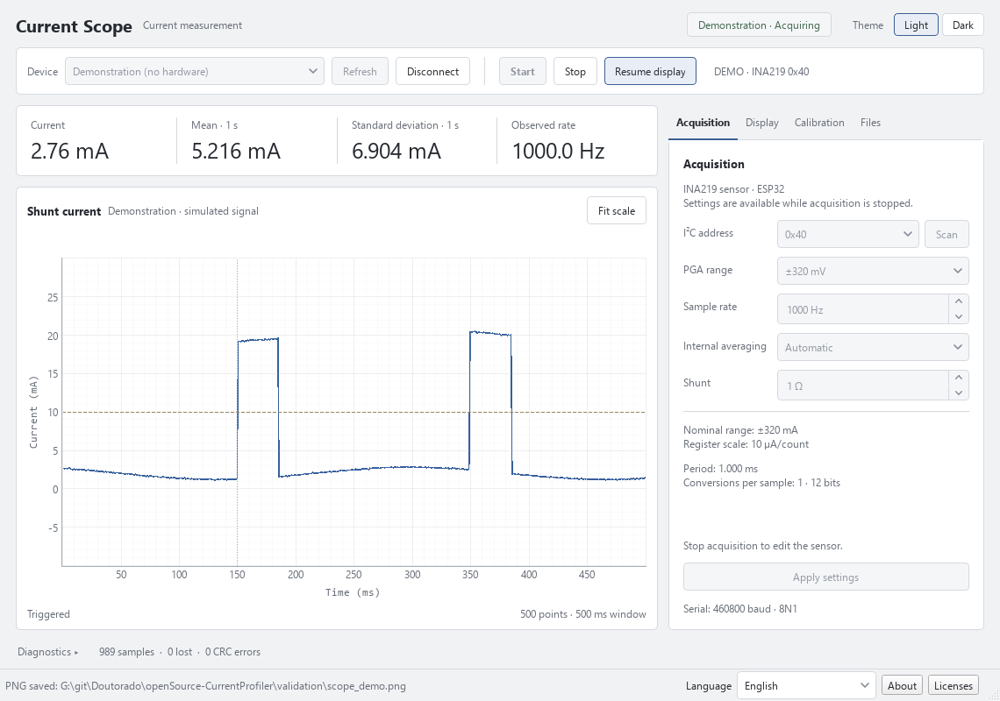

# Open Source Current Profiler

An ESP32 and INA219 current profiler for exploring how an IoT device draws current over time. The ESP32 acquires one shunt-voltage channel; the **IoT Current Scope** desktop application turns those readings into a live trace and records them for later analysis.

Created by **Wenderson Oliveira**. Source code, issues and updates are on [GitHub](https://github.com/wnoliveira/openSource-CurrentProfiler).

| Component | Version | Status |
|---|---|---|
| Desktop software | 1.0.0 | **In development** |
| ESP32 firmware | 1.0.0 | **In development** |
| Serial protocol | 1 | Implemented; hardware validation pending |

The hardware target is an **ESP32 DevKit with an ESP-WROOM-32 module and a CP2102 USB-to-UART bridge**. It does not require native USB. Development has used ESP-IDF 5.4.2 and Python 3.12 x64. A DEMO source lets you explore the interface without a board.



The screenshot and the files in `validation/` show simulated signals. They illustrate the workflow, not electrical performance. Read the [validation notes](VALIDATION.md) before interpreting measurements.

## Getting started

The [desktop guide](desktop/README.md) covers installation, language selection and Windows packaging. The [firmware guide](firmware/README.md) covers ESP-IDF. This page explains the measurement path and its design choices; the [protocol reference](docs/PROTOCOL.md) documents the wire format.

For a first look on Windows, open the `desktop` folder and run:

```powershell
.\run_windows.bat --demo
```

The launcher prepares Python 3.12 and installs the pinned dependencies on its first run. Start acquisition to view the simulated load. With real hardware, complete the wiring and calibration steps below first.

## What is measured

A resistor in series with the load produces a small differential voltage. The INA219 converts that voltage, and the ESP32 reads its signed shunt-voltage register. The raw register value travels to the computer without a calibration correction applied to it. Keeping this original value allows later inspection independently of the display units.

The computer calculates current using:

```text
shunt_voltage_V = raw_shunt × 10e-6
current_A = (raw_shunt − zero_raw) × 10e-6 × gain / shunt_ohm
```

Here, `zero_raw` is the measured offset for the selected range, `gain` is a dimensionless correction, and `shunt_ohm` is the resistance entered in the application. With a 1 Ω shunt, raw value 1000, zero offset 2 and gain 1, the result is 9.98 mA. Positive current flows from IN+ to IN−.

This version acquires **current only**. It does not acquire bus voltage or calculate power or energy. It bypasses the INA219's calculated current and power registers; the project's zero and gain procedures are separate from the chip's current-register calibration scheme.

The shunt register uses 10 µV per count across the PGA ranges. Changing range does not introduce an extra multiplier into the formula. The electrical characteristics and register definitions are in the [TI INA219 datasheet, sections 7.5 and 8.6](https://www.ti.com/lit/ds/symlink/ina219.pdf).

| PGA setting | Shunt-voltage range | Nominal current range with 1 Ω |
|---:|---:|---:|
| 0 | ±40 mV | ±40 mA |
| 1 | ±80 mV | ±80 mA |
| 2 | ±160 mV | ±160 mA |
| 3 | ±320 mV | ±320 mA |

These are input ranges, not accuracy claims. A 1 Ω shunt maps one register count to 10 µA. Noise, offset, temperature and effective converter resolution still matter. Extra decimal places do not establish that a sleeping device's few microamps have been measured accurately.

### Choosing the shunt

A larger shunt gives a larger signal at low current, but also increases the voltage lost before the load. With 1 Ω, 100 mA causes a 100 mV drop and dissipates 10 mW; 320 mA causes a 320 mV drop and about 102 mW. Check the resistor's rating and the effect on the device under test. Radio bursts can matter more than the average current.

Replace the breakout's original shunt when using a different value. Leaving it in parallel with an external resistor changes the effective resistance. Establish the resistance actually in the current path and enter it in the application. For an external shunt, connect sense wires directly to its terminals, separately from the wires carrying load current, to reduce lead-resistance error.

## Wiring

Make connections with power removed. Keep the logger's own supply outside the measured path so the result represents the intended load.

| ESP32 DevKit | INA219 breakout |
|---|---|
| 3V3 | VCC / VS |
| GND | GND |
| GPIO21 | SDA |
| GPIO22 | SCL |

| Measured circuit | Connection |
|---|---|
| Supply positive | IN+ / VIN+ |
| IN− / VIN− | Load positive |
| Supply negative | Load ground and INA219/ESP32 ground |

Power the breakout at 3.3 V so its I²C pull-ups do not put 5 V on the ESP32 pins. The firmware uses I²C at 400 kHz. Keep wires short and account for pull-ups already fitted when choosing external ones; 2.2–4.7 kΩ is a starting point to check against the actual wiring. Breakout LEDs or other circuitry can affect small-current readings if included in the measured path.

The chip supports bus voltages up to 26 V. This is separate from the much smaller differential voltage across the selected shunt range. Check the breakout, wiring and load as well as the [chip's electrical limits](https://www.ti.com/lit/ds/symlink/ina219.pdf).

## Building and flashing the ESP32

Install Espressif's ESP-IDF extension for VS Code and configure **ESP-IDF 5.4.2**. Open `firmware` as the project folder. From an ESP-IDF terminal:

```powershell
idf.py set-target esp32
idf.py build
idf.py -p COM5 flash
```

Replace `COM5` with the board's port. The flashing tool controls its own upload speed, independently of the application's fixed 460800 baud link. If programming does not start automatically, hold BOOT while the tool connects and release it once writing begins. Close the serial monitor before connecting the desktop application: both cannot own the same port.

SDA and SCL can be changed under **IoT Current Scope** in `idf.py menuconfig`. UART0 uses GPIO1/TX and GPIO3/RX, already connected to the DevKit's USB-to-UART bridge. Avoid attaching another device to these pins while using USB.

The firmware boots stopped, at PGA ±320 mV, requested rate 1000 Hz and automatic averaging. Zero and gain coefficients survive restart in NVS. Rate and range start from their defaults again. Existing prebuilt files describe an earlier build; rebuild current sources before testing changes on the board.

## From a sampling request to a reading

The ESP32 schedules acquisition against absolute deadlines:

```text
sample_deadline_us = session_epoch_us + slot_number × period_us
```

This avoids accumulating a conversion's execution time on top of every period. Plot refresh and USB arrival times do not set the sampling interval.

At each slot, the firmware writes the configuration for a **triggered, shunt-only conversion**, waits for the planned window and checks the conversion-ready flag. It then reads the shunt register and timestamps the completed I²C transaction. Checking the ready flag in the bus-voltage register does not enable bus-voltage acquisition. Failed I²C transactions or conversion timeouts lose that slot; they do not repeat an old reading.

If execution falls behind by whole periods, the sequence counter advances over them. Acquisition and transmission use separate FreeRTOS tasks and a queue of 32 messages. A full queue drops a sample and increments a diagnostic counter. A serial delay therefore remains visible instead of silently changing the intended schedule.

### Rate and averaging

The requested rate can be any integer from 1 to 1000 Hz. The period is rounded to whole microseconds. For example, 333 Hz gives 3003 µs, equivalent to approximately 333.0003 Hz. The device reports its accepted period; the application's observed rate comes from device timestamps.

The ADC remains in its 12-bit conversion mode. Internal averaging combines 1, 2, 4, 8, 16, 32, 64 or 128 conversions. Automatic averaging chooses the largest count that fits:

```text
586 µs × averaging_count + 350 µs <= sample_period_us
```

The 350 µs reserve is this firmware's allowance for communication and execution. The 586 µs single-conversion bound is extended proportionally for planning; that extrapolation is an implementation choice, not an additional guaranteed TI specification. Conversion-ready checks still decide whether a reading is usable.

| Requested rate | Period | Automatic count | Planned typical conversion window |
|---:|---:|---:|---:|
| 1000 Hz | 1 ms | 1 | 0.532 ms |
| 500 Hz | 2 ms | 2 | 1.060 ms |
| 250 Hz | 4 ms | 4 | 2.130 ms |
| 100 Hz | 10 ms | 16 | 8.510 ms |
| 50 Hz | 20 ms | 32 | 17.020 ms |
| 10 Hz | 100 ms | 128 | 68.100 ms |
| 1 Hz | 1000 ms | 128 | 68.100 ms |

These are the planning values used by the code. Reducing rate can give a quieter trace by allowing a longer average. With manual averaging, reducing rate alone leaves the count unchanged. An incompatible count is rejected instead of silently changing the request.

Longer averaging trades time resolution for reduced random variation. It does not remove shunt error, systematic offset or drift. Short pulses can be smoothed, and triggered conversions leave gaps between windows. At 1 Hz with 128 averages, the nominal 68.1 ms window covers only part of each second. A pulse outside it may go unobserved. These samples do not guarantee an unbiased average current for a pulsed IoT load. Use a higher rate and compare with a suitable reference when pulse amplitude, duration or charge matters.

### Why 460800 baud

ASCII lines travel over UART0 through the USB-to-UART bridge. Text helps during development because a line can be inspected without a custom binary viewer. Metadata uses compact JSON; samples use a shorter comma-separated format. Both carry a CRC.

The link is fixed at **460800 baud, 8 data bits, no parity, one stop bit (8N1), without RTS/CTS**. Each byte occupies 10 wire bits and takes about 21.7 µs. A longest sample line has 39 bytes and occupies about 846 µs. At 1000 samples/s, sample data alone needs 390000 bit/s, about 84.6% of the link. Periodic diagnostics add some overhead. A 230400 baud link cannot carry that worst case; 460800 retains a conventional UART rate with room for diagnostics. Changing sampling rate does not renegotiate the connection.

UART transmission overlaps acquisition in its separate task. The 350 µs planning reserve is therefore not an allowance for sending a complete sample line. The transmit queue absorbs brief delays; sustained congestion appears as dropped packets rather than extending every measurement period.

Samples have no individual acknowledgement or retransmission. Sequence numbers expose missing slots and CRC-16/CCITT-FALSE detects corrupted lines. The computer rejects malformed data and breaks the plotted trace at sequence gaps. These checks protect transport; they do not quantify measurement uncertainty. See the [protocol reference](docs/PROTOCOL.md) for framing, command ordering and errors.

## Calibration

First establish the shunt value and select a range that accommodates the load's peaks. Calibrate while acquisition is stopped. Coefficients are kept separately for all four PGA ranges. The resistance is a desktop setting; the firmware stores raw offset and gain, not a shunt resistance.

### Zero

Remove the load while keeping the INA219 powered. Allow the circuit to settle, then run zero calibration. The firmware collects 16 readings, each using 128 internal averages, and stores their mean as `zero_raw` for the current range. This takes roughly 1.2 seconds. An offset above 100 raw counts in magnitude is rejected to reduce the chance of zeroing an applied load.

The calibration event reports the raw mean and standard deviation. The zero-calibrated indicator means this offset procedure has been performed; it does not establish a traceable calibration of the whole instrument. Recheck zero after substantial temperature changes.

### Gain

After zeroing, apply a stable current measured with a suitable reference instrument and enter its value in mA. The application multiplies this by the entered resistance and sends the equivalent shunt voltage in µV. The firmware again takes 16 readings with 128 averages and calculates:

```text
gain = reference_shunt_voltage_uV / ((mean_raw − zero_raw) × 10)
```

The application requires a reference drop of at least 200 µV and below 90% of the range. The firmware also checks the corrected measured drop, rejects readings near full scale and accepts gain factors only from 0.5 to 1.5. A small reference is too sensitive to offset and noise; a saturated value cannot provide a useful gain fit.

Correct the shunt setting before using gain calibration to compensate for an error. A single fitted point cannot establish linearity. Compare several known currents, including the intended operating region, and record the reference instrument and environmental conditions.

Zero, gain and reset commands write ESP32 NVS. Changing rate or display scale does not. Recheck calibration after replacing the shunt or module, or changing measurement wiring. Selecting another PGA selects its own saved coefficients.

## Desktop operation

Connect to the board's port, confirm the address, enter the actual resistance and apply the desired range, rate and averaging. Calibrate as needed, then start acquisition. Sensor changes require a stopped acquisition and an explicit **Apply configuration** action. Display settings remain available while reading.

The INA219 has no chip-identification register. The firmware scans 0x08–0x77, considers plausible register responses at 0x40–0x4F and chooses the first candidate. A response is not proof of identity: begin with only the intended sensor on the bus, and select its address manually when more than one candidate is present.

The interface supports **English and Portuguese**. Choose **System default**, **English** or **Português** in the Language selector. System default follows the computer language: Portuguese selects Portuguese, English selects English, and other languages fall back to English. A manual choice is remembered and applies immediately. **About** shows the version, author and repository link. The [desktop guide](desktop/README.md) covers the individual controls.

### Display and trigger

Horizontal scale is ms/div across ten divisions, with a maximum 60-second window. Vertical scale is mA/div or µA/div across eight divisions, with an adjustable center. Autoscale fits the displayed points.

| Trigger mode | Behavior |
|---|---|
| Free | Shows the most recent window. |
| Auto | Aligns a recent threshold crossing when available; otherwise shows the latest window. |
| Normal | Updates after a crossing with a complete window; holds the previous frame while waiting. |
| Single | Holds the first complete triggered frame until rearmed. |

Rising and falling edges and 0–90% pre-trigger are supported. Trigger runs on the computer after acquisition. It does not trigger the INA219 and cannot recover an edge that was not sampled. Interpolation only positions a crossing in the display; exported values remain the acquired readings. Pausing the screen holds the view while acquisition and continuous recording continue.

### Time, recording and export

A timestamp marks the **end of the ESP32's I²C shunt-register read**, after conversion. It is not the integration window's center. The packet carries the low 32 bits of the microsecond timer; the computer expands it to a continuous 64-bit value within a session. The 32-bit value wraps about every 71.6 minutes. Tracking assumes less than half a wrap, about 35.8 minutes, between accepted timestamps. An active link is disconnected after four seconds without received bytes.

Each START creates a new session. Relative time comes from the ESP32 timer. CSV `timestamp_utc_estimated` is anchored to the computer clock when START is acknowledged. USB latency, clock error and oscillator drift affect it; it is not absolute synchronization with another instrument.

| Output | Contents |
|---|---|
| Continuous CSV | All accepted samples received after capture starts, independent of the display or trigger. |
| Screen CSV | Acquired points in the displayed window, plus horizontal `scope_x_s` positions. |
| Screen PNG | Plot, axes and trigger markers in the selected theme. |

Each CSV has a `.csv.json` sidecar with session settings. Columns include raw shunt voltage, corrected A/mA/µA, device time, sequence, flags, missing samples, PGA, resistance and calibration coefficients. Capture closes on STOP, disconnect or a recording error. Files are flushed periodically; sudden power loss can still lose buffered data.

Compare the PC missing-sequence count with firmware I²C errors, skipped periods, transmission drops and timing diagnostics when investigating gaps. They describe different stages of the same path. Adding them together would count some failures twice.

## Checks and Windows packaging

With dependencies installed, run the Python checks from the repository root:

```powershell
.\desktop\.venv\Scripts\python.exe -m unittest discover -s tests -v
.\desktop\.venv\Scripts\python.exe -m unittest discover -s desktop/tests -v
```

The core suite also compares the C planner with Python when a supported host compiler is available. This is separate from an ESP-IDF build. GUI and capture tests use simulated data. The [validation record](VALIDATION.md) distinguishes checks performed from work that still requires the ESP32 and a reference load.

Run `desktop/build_windows.bat` to build the Windows application. It builds a single-file PyInstaller package, exercises a DEMO self-test and creates an application-source archive. Output is `desktop/dist/IoTCurrentScope.exe`; the destination computer does not need Python. A CP210x driver may still be needed. Build on Windows with Python 3.12 x64. Historical Linux packaging results do not establish that a Windows build works.

## License and attribution

This project follows **GNU GPL version 3**, provided in [LICENSE](LICENSE). The desktop license copy matches the repository. Earlier draft files incorrectly described the whole package as MIT; the original desktop notice is retained in `desktop/licenses/PROJECT-ORIGINAL-MIT.txt`.

Dependencies retain their own terms. The main licenses are compatible with a GPLv3 project, but distributing an executable or firmware image also requires applicable notices and corresponding source. The generated application-source ZIP does not contain the full sources of Qt, PySide6, Shiboken or ESP-IDF. Read the [license review](THIRD_PARTY.md) and [desktop distribution notes](desktop/THIRD_PARTY.md) before publishing binaries.

## Technical references

- [INA219 datasheet](https://www.ti.com/lit/ds/symlink/ina219.pdf), for electrical characteristics and registers.
- [ESP-IDF 5.4.2 I²C driver](https://docs.espressif.com/projects/esp-idf/en/v5.4.2/esp32/api-reference/peripherals/i2c.html) and [UART driver](https://docs.espressif.com/projects/esp-idf/en/v5.4.2/esp32/api-reference/peripherals/uart.html).
- [pySerial API](https://pyserial.readthedocs.io/en/latest/pyserial_api.html), for the host connection.
- [Project repository](https://github.com/wnoliveira/openSource-CurrentProfiler), for source, issues and changes.
